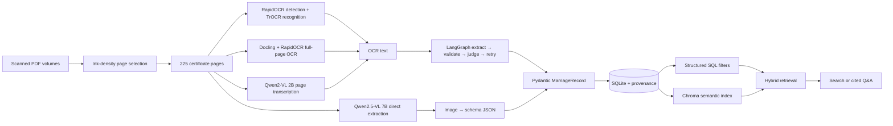
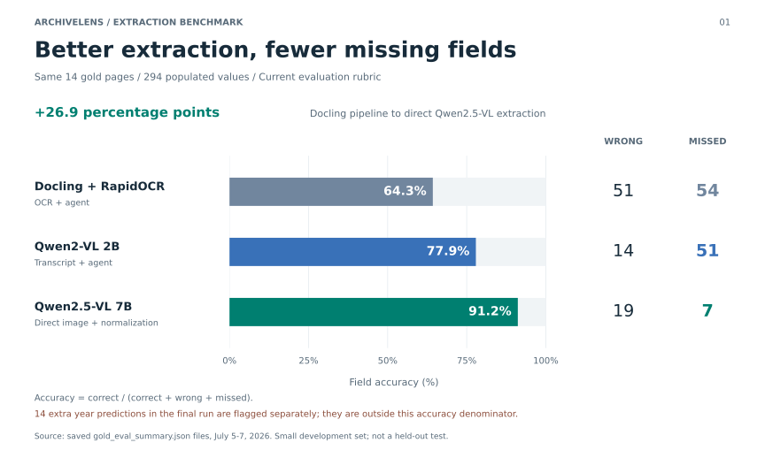
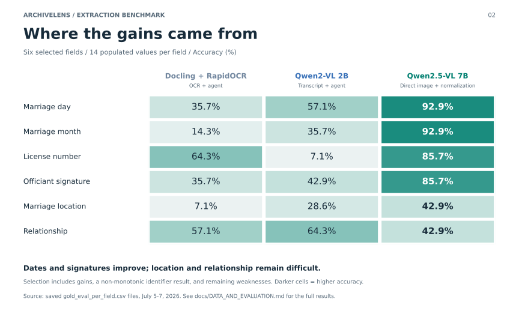

# ArchiveLens

### From ink to index: optimizing historical document extraction from 54% to 90%

ArchiveLens turns scanned Baltimore City marriage certificates from the 1930s and
1940s into structured, searchable records. The project is an experiment in
**document understanding under noisy OCR**, with retrieval and question answering
built on top of the extracted evidence.

> **Headline result:** structured-field accuracy improved from **54.1% to 89.8%**
> on the same 14-page human-labeled benchmark using the original evaluation
> rubric. Under the current project evaluator, the
> corresponding progression is **61.6% to 91.2%**.

The improvement came from changing the document pipeline—not from adding a larger
chat model. The project moves from line-level OCR, through full-page and
vision-language transcription, to direct image-to-schema extraction. Every run is
measured against human labels and preserved with page-level provenance.


## The problem

Historical forms are difficult for ordinary OCR because they mix:

- printed labels, handwriting, signatures, ruled lines, and stamped values;
- abbreviations such as `BALTO MD`, `WHT`, and `COL`;
- labels fused to values, such as `COLNativity` and `OccupationONE`;
- scanned blank backs interleaved with certificate fronts;
- visually similar fields repeated for the groom and bride; and
- values whose meaning depends on their position in the form.

A plausible transcript is not enough. A researcher needs dependable fields:
names, ages, residences, occupations, marital status, date, license number, and
officiant—with a link back to the source page.

## Why this is more than another RAG project

RAG is the last stage. Most of the engineering is devoted to producing evidence
worth retrieving:

1. Detect certificate pages instead of assuming odd/even page order.
2. Compare OCR and vision pipelines on the same gold labels.
3. Convert noisy page evidence into a typed `MarriageRecord` schema.
4. Validate values, preserve nulls, and track wrong, missed, and hallucinated
   fields separately.
5. Store provenance with every record.
6. Build hybrid SQL + vector retrieval only after extraction is complete.

Search never reruns OCR. It operates on versioned structured records, so extraction
quality can be improved independently from retrieval and Q&A.

## Architecture



There are two deliberate extraction architectures:

- **OCR → agent:** Docling/RapidOCR or Qwen2-VL produces text; a LangGraph agent
  extracts, validates, judges, and may retry the record.
- **Image → schema:** Qwen2.5-VL reads the page and emits the record directly,
  removing the lossy transcript boundary and the extraction agent.

See [Architecture](docs/ARCHITECTURE.md) for component responsibilities,
artifacts, provenance, and runtime paths.

## Optimization journey

### 1. Establish a line-OCR baseline

`microsoft/trocr-base-printed` is designed for single text-line images. RapidOCR
first detects line boxes, TrOCR recognizes each crop, and the lines are reassembled
before schema extraction. This created a measurable baseline, but page layout and
handwriting were easily lost.

### 2. Use full-page OCR and repair recurring form errors

Docling + RapidOCR performs forced full-page OCR on these image-only PDFs. A
conservative cleanup layer separates glued labels and repairs known OCR confusions
without broadly rewriting the document.

### 3. Replace classical transcription with a local VLM

Qwen2-VL 2B transcribes the entire page on Apple Silicon through MLX. Holding the
downstream agent fixed reduced wrong values from 51 to 14 in the saved gold runs,
but 51 values were still missed. The error profile showed that transcription had
become more accurate without becoming complete.

### 4. Remove the transcript boundary

Qwen2.5-VL 7B receives the page image and target JSON schema together. Direct
image-to-schema extraction recovered fields the transcript pipeline omitted,
especially dates, identifiers, and signatures.

### 5. Normalize representations revealed by error analysis

Typed coercion handles values such as `5th` → `5`, consent phrases → booleans,
and short color codes such as `COL.` → `COL`. The color normalization alone fixed
five exact-match errors in the saved corpus predictions, moving the current score
from **89.5% to 91.2%** without rerunning the model.

## Gold-set results

The gold set contains **14 hand-labeled pages**, sampled from both source volumes.
The current evaluator scores **22 fields** and contains **294 populated gold
values**. Accuracy is:

```text
correct / (correct + wrong + missed)
```

True-null fields are excluded from the denominator. Predictions made where gold is
null are reported separately as hallucinations.



The three saved runs show a **26.9 percentage-point gain** from Docling/RapidOCR
to direct Qwen2.5-VL extraction. The smaller VLM first reduces wrong values;
direct extraction then reduces omissions. The final run recovers **268 of 294**
populated gold values, with 19 wrong and 7 missed.

The final run also produces **14 extra numeric-year predictions** where the gold
labels require null. These are flagged separately and excluded from headline
accuracy; the metric does not penalize them in its denominator.

The original notebook rubric produces the clean, like-for-like project headline:
**159/294 correct (54.1%) → 264/294 correct (89.8%)**, or 105 additional correctly
recovered fields.



The second figure keeps six informative fields: date components, license number,
signature, location, and relationship. It includes the relationship regression
from Qwen2-VL to Qwen2.5-VL. The complete field breakdown stays in the evaluation
artifacts rather than crowding this overview.

Detailed scoring rules, field-level results, and limitations are documented in
[Data and evaluation](docs/DATA_AND_EVALUATION.md).

[Download the two-page visual report](gold-ocr-comparison-report.pdf).
Figures are rebuilt from saved JSON/CSV results with
[`scripts/build_readme_figures.py`](scripts/build_readme_figures.py); no model
inference is needed. Run it with a Python environment containing Matplotlib, then
run it with `--pdf-only` in an environment containing ReportLab to rebuild the PDF.

## Lightweight detector experiment

The next optimization asks a different question: can a small detector reduce the
visual workload sent to the heavy recognizer?

The experimental path uses a **4.75 MB PP-OCRv4 mobile DB detector** with ONNX
Runtime, then packs detected text bands into a smaller image for the same local
Qwen2.5-VL 7B model. On all 14 gold images, guarded packing retained a median
**56.6% of the original pixels**. In the interrupted pilot, packed inputs reduced
the median prompt from 2,823 to 1,757 tokens (about 38%), but latency did not yet
improve and several fields regressed.

That is a useful result: fewer visual tokens do not automatically mean a faster or
more accurate pipeline. Detection misses and altered layout can remove context,
especially around handwriting and signatures. The experiment therefore includes
an ink-preservation guard and records accuracy, latency, tokens, memory, and crop
previews together. It is an active optimization track, not part of the 91.2%
headline.

See [Optimization experiments](docs/OPTIMIZATION.md) for the protocol and early
findings.

## Record schema

Each certificate becomes a typed record with these groups:

| Group | Fields |
|---|---|
| Identifiers | license number, application number |
| Marriage event | day, month, numeric year, year text, location |
| Groom | name, residence, age, color code, nativity, occupation, marital status |
| Bride | name, residence, age, color code, nativity, occupation, marital status |
| Consent and relationship | groom consent, bride consent, parents' consent filed, relationship |
| Officiant | signature, official character, address |
| Provenance | source PDF, source page, OCR/extraction engine |

The evaluation intentionally scores a 22-field subset; boilerplate and provenance
are not counted as document-extraction wins.

## Models and components

| Role | Model or component | Why it is here |
|---|---|---|
| Blank-page filtering | Low-resolution ink ratio | Handles alternating scan backs without assuming page parity |
| Text detection | RapidOCR / PP-OCR DB detector | Finds text regions cheaply |
| Line recognition baseline | `microsoft/trocr-base-printed` | Establishes a detector–recognizer baseline |
| Full-page OCR | Docling + RapidOCR | Reads scanned PDFs with layout-aware full-page OCR |
| Local transcription | Qwen2-VL 2B Instruct, 4-bit MLX | Tests VLM transcription with the same extraction agent |
| Direct extraction | Qwen2.5-VL 7B Instruct, 4-bit MLX | Emits structured JSON directly from page images |
| Structured extraction | GPT-4o mini or Gemini 2.5 Flash | Produces typed records from OCR text |
| Agent orchestration | LangGraph | Extracts, validates, judges, and retries |
| Validation | Pydantic | Enforces the `MarriageRecord` contract |
| Persistence | SQLite | Stores canonical records and provenance |
| Retrieval | SQL + Chroma | Combines exact filters with semantic similarity |
| Interface | Streamlit | Supports upload, browse, search, evaluation, and cited Q&A |

## Repository layout

```text
app/
  agents/          LangGraph extraction, validation, judge, retry
  db/              SQLite repository and provenance queries
  extraction/      Text extraction and direct Qwen2.5-VL extraction
  ocr/             Docling, VLM, rendering, cleanup, DB detector experiment
  pipeline/        Orchestration, gold evaluation, plots, label loading
  rag/             Record serialization, hybrid retrieval, Chroma, Q&A
artifacts/          Checkpoints, predictions, evaluation CSVs, plots, reports
data/               Raw/processed PDFs, SQLite databases, Chroma indexes
docs/               Architecture, evaluation, and optimization documentation
gold/               14 page images and human-created labels
notebooks/          Exploration and baseline experiments
scripts/            Reports, plots, and reproducible optimization benchmark
tests/              Registry and detector-packing tests
streamlit_app.py    Interactive application
```

## Quick start

Requirements:

- Python 3.11
- [`uv`](https://docs.astral.sh/uv/)
- Apple Silicon for the local MLX VLM paths
- an OpenAI or Google API key for agent extraction and generated RAG answers

```bash
uv python pin 3.11
uv venv --python 3.11
uv sync --extra dev
cp .env.example .env
```

Add one provider key to `.env`, then launch the app:

```bash
make ui
```

To rebuild the searchable Docling corpus from saved extractions:

```bash
make import-batch
make rag-index-docling
```

To run the saved gold workflows:

```bash
make run-gold-docling
make run-gold-vlm
make run-gold-qwen25
```

To scan the full 225-page corpus directly with Qwen2.5-VL:

```bash
make scan-qwen25-corpus
make rag-index-qwen25
```

To run the detector experiment after downloading the pinned detector listed in
`app/ocr/dbnet_regions.py`:

```bash
.venv/bin/python -B -m scripts.benchmark_dbnet_qwen \
  --output artifacts/optimization/my-run
```

## Reproducibility and limitations

- The gold set is a small development benchmark: 14 pages, not an estimate for
  every historical certificate.
- Model selection and normalization were informed by this gold set; there is no
  untouched test split yet.
- Selected free-text fields use fuzzy matching at a 0.85 similarity threshold.
- Numeric identifiers compare digit sequences; other fields are normalized for
  case and whitespace and generally require exact values.
- Historical race/color terminology is preserved because it is part of the source
  record. It is not modernized or endorsed.
- Qwen2.5-VL occasionally infers a numeric year from written text. The evaluator
  records these as hallucinations when the gold numeric field is null.
- Local VLM performance and memory measurements are hardware-dependent.

## Documentation

- [Architecture and data flow](docs/ARCHITECTURE.md)
- [Dataset, schema, and evaluation](docs/DATA_AND_EVALUATION.md)
- [Optimization experiments](docs/OPTIMIZATION.md)
- [Gold-labeling instructions](gold/README.md)
- [Focused comparison report](gold-ocr-comparison-report.pdf)

