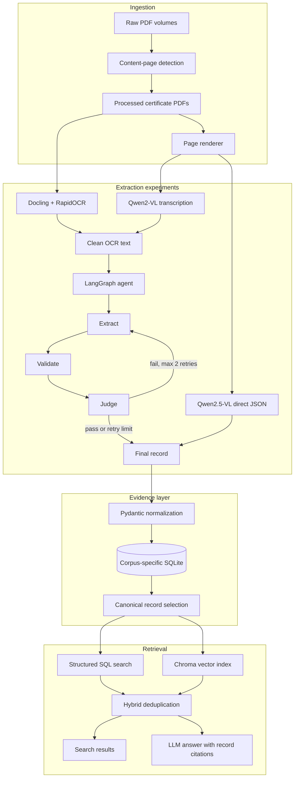
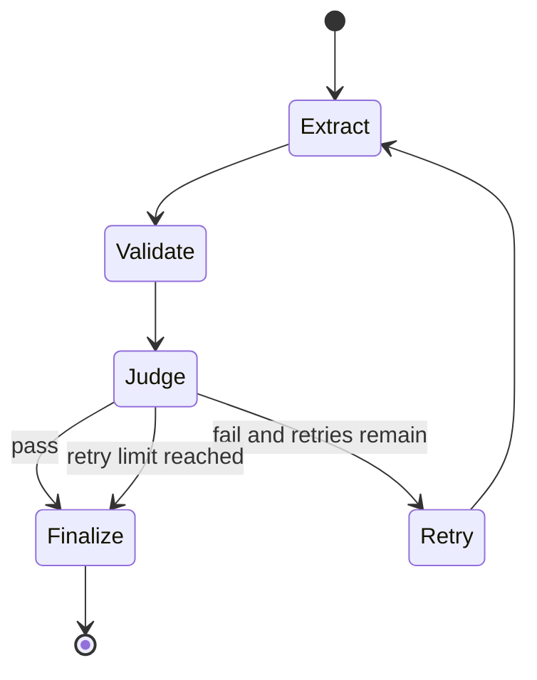

# Architecture

ArchiveLens is a document-understanding system with multiple interchangeable
extraction paths. The architecture separates expensive page interpretation from
storage and retrieval, allowing OCR/VLM experiments to be evaluated without
rewriting the search layer.

## System view

## 1. Page ingestion

The two source PDFs alternate certificate fronts with blank scan backs, but the
content parity differs by volume. The preprocessing notebook renders pages at low
resolution and measures the fraction of dark pixels. It compares the median ink
ratio of the two parity groups and selects the group containing documents.

This produced:

- `1_content.pdf`: 131 certificate pages
- `2_content.pdf`: 94 certificate pages
- total: 225 pages

The median makes the decision robust to an unusually dark or noisy blank page. If
neither parity appears blank, the code keeps every page instead of discarding half.

## 2. OCR-to-agent path

The text path is used by both classical OCR and VLM transcription.

### OCR backends

`app/ocr/registry.py` selects one of two production backends:

- `docling`: Docling with RapidOCR and forced full-page OCR
- `vlm`: local Qwen2-VL 2B transcription through MLX

The earlier TrOCR experiment lives in `notebooks/trocr-ocr.ipynb`. RapidOCR finds
line boxes; `microsoft/trocr-base-printed` recognizes each crop in batches.

### Domain cleanup

`app/ocr/cleanup.py` handles recurring form-specific failures such as fused labels
and conservative whole-word confusions. The cleanup is deliberately narrow. It
does not attempt general spelling correction because changing a historical name is
worse than retaining a visible OCR error.

### LangGraph extraction

`app/agents/graph.py` compiles this state graph:

The extractor uses structured model output to construct `MarriageRecord`. Local
validators check required names, plausible ages, a plausible year range, date
consistency, and obvious name noise. During gold evaluation, a separate judge
checks whether non-null values are supported by the OCR text. Bulk ingestion can
skip the judge to avoid an extra model call per page.

## 3. Direct image-to-schema path

`app/extraction/vlm_zeroshot.py` sends the page image and complete target schema to
Qwen2.5-VL 7B. The model emits JSON directly, so there is no intermediate text
transcript and no LangGraph extraction call.

The pipeline then:

1. removes markdown fences or stray text around the JSON object;
2. coerces ordinal/numeric values into typed integers;
3. normalizes boolean consent phrases and short color codes;
4. validates the payload with Pydantic; and
5. assigns source PDF, page, and engine metadata in trusted application code.

Provenance is never accepted from model output.

## 4. Persistence and corpus isolation

Each extraction family has a separate database and vector index:

| Corpus | Database | Chroma directory | Preferred engine |
|---|---|---|---|
| `docling` | `records.db` | `rag_index/` | `docling-rapidocr` |
| `vlm` | `records_vlm.db` | `rag_index_vlm/` | `agent+qwen2-vl-2b` |
| `qwen25` | `records_qwen25_zeroshot.db` | `rag_index_qwen25/` | `zeroshot+qwen2.5-vl-7b` |

This prevents a better extraction run from silently mixing with an older corpus.
Records are keyed operationally by source PDF, source page, and engine. Long model
runs append to JSONL checkpoints so they can resume after interruption.

## 5. Retrieval and Q&A

`MarriageRecordRetriever` combines two retrieval strategies:

- structured SQLite filters for years, names, and recognized occupation terms;
- semantic similarity over Chroma documents generated from complete records.

Results are deduplicated by record ID and source page. The Q&A layer receives only
retrieved records and is instructed to cite their record IDs. It does not see the
source scan and does not rerun extraction.

This boundary matters: RAG quality cannot repair an incorrect marriage date or a
misspelled person name. Extraction quality is therefore measured and optimized
before retrieval quality.

## 6. Interface and operational paths

The Streamlit application provides:

- corpus selection across all three extraction families;
- upload and extraction for OCR-backed corpora;
- browsing of structured records and provenance;
- gold-set evaluation controls;
- retrieve-only search; and
- cited RAG answers.

The command-line interface in `app/cli.py` exposes the same core workflows for
batch runs and reproducibility.

## Main implementation map

| Area | Primary files |
|---|---|
| Configuration and prompts | `app/config.py` |
| Schema and normalization | `app/schema.py` |
| OCR | `app/ocr/docling.py`, `app/ocr/vlm.py`, `app/ocr/cleanup.py` |
| Direct VLM extraction | `app/extraction/vlm_zeroshot.py` |
| Agent | `app/agents/graph.py`, `nodes.py`, `validators.py` |
| Orchestration | `app/pipeline/orchestrator.py`, `app/ingestion/service.py` |
| Evaluation | `app/pipeline/eval.py`, `gold_plots.py` |
| Persistence | `app/db/repository.py` |
| Retrieval | `app/rag/retriever.py`, `index.py`, `documents.py` |
| Q&A | `app/rag/qa.py`, `service.py` |
| UI and CLI | `streamlit_app.py`, `app/cli.py` |
